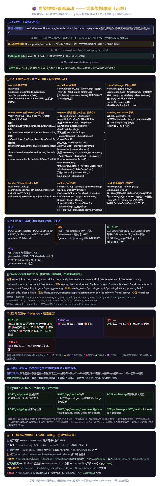

# 血染钟楼 · 暗流涌动 — 在线桌游平台（Go 微服务版）

> 基于《血染钟楼·暗流涌动》（Blood on the Clocktower: Trouble Brewing）的多人在线社交推理桌游，
> 支持真人玩家与大模型 AI 玩家混合对局、纯 AI 电子斗蛐蛐观战、大模型智能体竞技场。
>
> 技术栈：Go（游戏主服务）+ Python Flask（AI 推理服务）+ Vue3（前端）

---



## 目录

- [项目由来与演进史](#项目由来与演进史)
- [系统实现流程与语言逻辑](#系统实现流程与语言逻辑)
- [借鉴与改造](#借鉴与改造)
- [快速开始](#快速开始)
- [完整功能清单](#完整功能清单)
- [架构设计](#架构设计)
- [AI 玩家体系](#ai-玩家体系)
- [规则口径说明](#规则口径说明)
- [开发中遇到的问题与解决](#开发中遇到的问题与解决)
- [环境变量](#环境变量)
- [项目结构](#项目结构)
- [部署](#部署)

---

## 项目由来与演进史

本项目从一个纯 Python 单机 AI 对局模拟器开始，历经六个大版本（V1-V4 旧 Python 版、V5-V6 Go 重构版），
完整历史存档见 [Blood-on-the-Clocktower-](https://github.com/pengjunhao2810/Blood-on-the-Clocktower-)。

| 版本 | 形态 | 关键能力 |
|------|------|----------|
| V1 经典版 | Python Flask 单机，纯模板发言 | 22 角色规则引擎雏形 |
| V2 增强版 | + 人格系统（4 性格）+ ML 训练（REINFORCE） | 说话像人了一点 |
| V3 独立版 | 独立包 + 16 项规则硬约束 + 信息交叉投票 | 规则更严谨、可导出 Word |
| V4 精简版 | 删 ML、删垃圾文件 | 更干净 |
| V5 Go 重构 | Go 微服务 + Python AI 推理 + Vue3 前端 | 真人在线联机、房间制、混合对局、多模型竞技场、观战模式 |
| **V6（本版）** | **V5 基础上持续演进** | **剧本演绎模式、对局质量统计、守鸦人死当晚查验、说书人假线索合理化、私聊削峰与动态概率、提示词强化（信息格式速查/自爆禁词/死亡规则）、多项稳定性修复（跨天死锁/事件循环阻塞/并发饿死）** |

旧版（V1-V6）的"未来计划"里写了三件事——**真人联机、外接 AI API、观战模式**——Go 重构版全部落地：

1. **真人玩家联机**：WebSocket 房间制，任意比例真人+AI 混合对局，身份私密（服务端脱敏下发）
2. **外接大模型 API**：9 大服务商（DeepSeek/智谱/Kimi/通义/混元/硅基流动等），座位级独立配置——同一局里恶魔用 GPT、镇民用 Ollama 本地模型，即"智能体竞技场"
3. **观战模式（电子斗蛐蛐）**：房主不占座，上帝视角看全部私聊、真实角色（酒鬼显示真身）、说书人记录，赛后完整复盘

---

## 系统实现流程与语言逻辑

### 语言选型逻辑

| 语言 | 承担职责 | 选型理由 |
|------|----------|----------|
| **Go** | 游戏主服务：HTTP 入口、WebSocket 长连接、房间状态机、22 角色规则引擎 | ①goroutine 天然契合"每房间一个 Actor"的并发模型，免锁串行处理对局事件；②编译型单二进制部署，规则确定性裁决不依赖运行时环境；③Gin + gorilla/websocket + GORM 生态成熟 |
| **Python** | AI 推理服务：发言生成、决策生成、笔记记忆、发言检测 | ①大模型 SDK 与 AI 生态最丰富，调 API 一行代码；②提示词拼接、正则清洗等文本处理开发效率高；③与主服务 HTTP 解耦，可独立重启、独立扩容 |
| **Vue3 + Element Plus** | 单页前端：大厅、房间、对局、观战界面 | ①组件化开发，房间/座位/消息流/弹窗全部复用；②响应式数据绑定天然适配 WebSocket 推送的实时状态；③本地 vendor 免 CDN 依赖 |

### 组件机制

```
前端 (Vue3 SPA)                    Go 主服务 (8741)                    Python AI 服务 (8742)
┌──────────────────┐    WS 全双工    ┌────────────────────────────┐   HTTP   ┌──────────────────────┐
│ 视图层（大厅/房间/ │ ─────────────► │ ws.Hub：连接注册表           │ ───────► │ /api/speak 四层提示词  │
│ 对局/观战）       │                │   · 房间广播域               │          │ /api/decide 先推理后决 │
│ 状态层（Vue ref） │ ◄───────────── │   · 用户定向推送             │ ◄─────── │ 策                    │
│ WS 客户端（重连） │   事件+快照     │ room.Actor（每房间一 goroutine）│          │ 笔记/检测/战术/降级    │
└──────────────────┘                │   · events channel 串行       │          └──────────────────────┘
                                    │   · 对局状态机驱动            │
                                    │ engine：22 角色规则（纯内存） │          DeepSeek/智谱/任意
                                    │ GORM + SQLite（离线数据）     │          OpenAI 兼容 API
                                    └────────────────────────────┘
```

- **ws.Hub**：维护"用户↔连接"与"连接↔房间"双向索引；广播分房间域，私密信息走定向推送；上下线 5 秒防抖
- **room.Actor**：所有状态修改经 `events chan` 串行执行，goroutine 内无锁；AI 调用全部异步，结果经事件回投
- **engine**：游戏规则与运行时状态分离——夜晚顺序、中毒时序、胜负判定全部确定性结算，不依赖 LLM
- **aiclient**：Go 侧 HTTP 客户端，40 秒超时 + 无代理直连；Python 侧信号量限流防并发打满
- **前端**：WS 唯一实时通道（无轮询）；断线指数退避重连 + 快照回执恢复

### 对局实现流程（端到端）

```
创建房间 → 设置人数 → 添加 AI 席位（key 连通性校验）→ 开局
  ├─ 发牌：匿名编号打乱 + 官方人数表配板 + 首夜信息（身份/线索/恶魔爪牙互认）
  ├─ 夜晚：按官方行动顺序逐角色唤醒
  │    · 主动型角色（恶魔/投毒者/僧侣/占卜师等）→ AI decide 选目标 → 引擎结算
  │    · 信息型角色 → 说书人线索注入玩家私密记录
  ├─ 天亮：死亡结算（僧侣保护/镇长弹刀/守鸦人遗言查验）→ 胜负判定
  ├─ 私聊阶段（60s）：AI 按动态概率发起会话；邪恶方必先碰头
  ├─ 公聊阶段（120s）：轮转制发言（每人每阶段 ≤3 次）+ 六道过滤关卡
  ├─ 提名阶段：AI/真人提名 → 辩论 20s → 同时投票 20s → 60s 冷却
  │    · 投票判定：唯一最高票且过半 → 处决；否则平安日
  ├─ 循环昼夜直至胜负分晓（恶魔死亡=善良胜；好人杀尽=邪恶胜；特殊条件）
  └─ 终局：归档对局日志（含对局质量统计）→ AI 自动复盘 → 返回等待房间
```

### 状态一致性保障

- **服务端为准**：前端永不自行结算规则，一切以引擎快照为准
- **脱敏下发**：真人只收到自己可见的信息（身份/线索按需过滤），观战房间才下发完整信息
- **断线恢复**：WS 重连自动 `room.join` 拉全量快照；服务重启从 SQLite 恢复等待房间与进行中对局
- **AI 无状态**：Python 侧不存对局数据（仅存笔记），对局状态全部在 Go 引擎内存中

---

## 借鉴与改造

本项目最初因看到 [BloodArena](https://github.com/BloodArena/BloodArena)（纯前端 LLM 血染钟楼 + AI 对战评测平台）而立项。以下是借鉴清单与我们的改造：

| 借鉴点 | 原文做法 | 我们的改造 |
|--------|----------|-----------|
| **每日总结压缩** | 每天白天结束并行生成玩家总结，防长局 context 超限 | 跨天时把前一天笔记流水 LLM 压缩成一段总结，注入后续推理 |
| **赛后 AI 复盘** | 赛后点击"生成复盘" | 对局结束自动异步生成说书人视角复盘，写入对局记录+导出 Word |
| **邪恶密聊** | 首夜后公聊前强制一轮密聊（每人 3 条） | 私聊阶段邪恶方 100% 先碰头统一口径，恶魔分配伪装身份、下达指令 |
| **Benchmark 均衡配板** | 5 组专业配板 × 12 局轮转、每模型恰演每角色一次 | 5 组 8 人均衡配板，斗蛐蛐开局随机轮转 |
| **LLM 轨迹记录** | 导出含 prompt 的轨迹文件 | 环境变量开关（BOTC_TRACE=1），落盘 trace.log |
| **@ 提及** | 公聊 @ 点名 | 输入框 @ 弹玩家列表，AI 被点名后优先回应 |
| **座位环标注** | 点击座位标注猜测角色 | 真人点击座位记录自己的猜测（仅自己可见） |

未借鉴的部分（出于架构差异）：TTS 语音播报、BGM 歌单、AI 说书人（我们保留硬编码引擎——规则确定性优先）。

---

## 快速开始

```bash
# 双击根目录「启动服务器.bat」一键启动
# 或手动：
cd botc_server && start_server.bat   # Go 主服务（8741）
cd ai_service && start_ai.bat        # Python AI 服务（8742）

# 浏览器打开 http://127.0.0.1:8741
```

- 不启动 AI 服务也能玩：夜晚行动回退随机策略，API 型 AI 静默跳过
- 每个 AI 座位可单独配置模型（Key/地址/模型名），添加时自动做连通性校验

---

## 完整功能清单

### 账号与社交
- 注册/登录（图形验证码 + bcrypt 密码哈希 + session cookie）
- 好友系统：搜索/申请/同意/拒绝/删除，在线状态实时推送（5 秒防抖）
- 房间邀请：房主邀请在线好友入座（一人一房互斥校验、TTL 5 分钟）
- 个人资料编辑、战绩统计（总场次/胜场/胜率）、历史对局回放

### 房间与对局
- 房间制：创建/加入/公聊/准备/人数设置（5-12 人）/AI 席位（大模型）
- 断线重连 + 刷新恢复（sessionStorage + 快照回执）；服务重启后等待房间自动恢复
- 对局结束归档（含说书人记录过滤、私聊日志），一键导出 Word 复盘

### 游戏引擎（暗流涌动 22 角色）
- 官方人数板子（5-12 人）、首夜/其他夜行动顺序、匿名编号
- 特殊规则：红唇女郎继承（≥5 人）、小恶魔自杀传位、贞洁者触发、猎手开枪、
  圣徒禁票、镇长弹刀（动态概率）、镇长日、占卜师红鲱鱼、酒鬼伪装（线索无标记）、
  陌客干扰、男爵 +2 外来者、管家跟随投票（主人投赞成才计入）、死亡票（一次）、
  中毒（持续到第二天提名结束）、守鸦人死后查验
- 提名制：每人每轮一次提名权、被提名者不重复、辩论 20 秒→投票 20 秒→
  60 秒冷却窗口内可继续提名→统一比对处决（唯一最高票且过半）

### 电子斗蛐蛐（观战模式）
- 房主不占座，纯 AI 对局；私聊 60s/公聊 120s 自动推进
- 上帝视角：私聊会话卡片（点击查看）、说书人记录（技能/提名/投票/处决）、
  真实角色（酒鬼显示真身）、赛后完整复盘 + AI 复盘 + 导出 Word
- 5 组均衡配板轮转

### 大模型 AI 玩家（详见下文）

---

## 架构设计

```
浏览器 (Vue3 + Element Plus，本地 vendor)
   │  HTTP（仅认证/建房/静态资源）
   │  WebSocket（全部实时交互）
   ▼
Go 游戏主服务 (Gin + gorilla/websocket + GORM/SQLite)
   ├── Hub         连接注册表（房间广播域/用户定向推送/上下线防抖）
   ├── Room Actor  每房间一个 goroutine，事件 channel 串行驱动（免锁）
   ├── engine      游戏引擎（纯内存无 IO，规则确定性）
   ├── FriendService 好友业务 + 内存邀请
   └── HTTP ──► Python AI 服务 (Flask)
                    ├── 发言/决策/笔记/人格/战术体系
                    └── DeepSeek/智谱/任意 OpenAI 兼容 API
```

核心设计：

1. **每房间一个 goroutine（Actor 模型）**——所有状态修改经 events channel 串行执行，
   天然免锁；单个房间 panic 被 recover 隔离不影响其他房间
2. **WebSocket 全双工指令协议**——HTTP 只留认证/建房/静态；聊天/指令/广播/私密信息全走 WS
3. **AI 调用全程异步**——所有 LLM 调用在独立 goroutine，结果经事件回投房间循环，
   绝不阻塞事件循环（详见"遇到的问题"第 2、3 条）
4. **脱敏下发**——真人玩家永远拿不到别人的角色/阵营/私密线索（快照级脱敏）；
   观战房间才下发完整信息

---

## AI 玩家体系

### 四层 Prompt 金字塔
```
① 阵营核心目标（最高优先级）
   善良：恶魔死亡即获胜，重点是盘出恶魔伪装路线，别怕票错好人
   邪恶：隐藏身份活到最后 + 服从协同体系（分配伪装/指令/汇报）
② 角色规范（一句技能+一句策略，22 角色全覆盖）
③ 场景规则（公聊三种开口模式：报信息/明确保留/信息链条推理；
   私聊三思/收尾话/严禁虚构对方发言；提名一次权提示）
④ 上下文：天数、存活名单、环形座位、夜晚规则、官方板子配置、
   死亡提示（死亡票）、笔记时间线、私聊记忆、最近对话
```

### 笔记系统（记忆闭环）
- 时间线日志（带 [D 天] 前缀）：听到谁说/我说过/系统事件/说书人信息
- 结构化字段：公开身份/怀疑对象/信任对象/战术目标
- 私聊总结（按对方编号隔离）、每日总结压缩（跨天自动）
- 所有写读线程安全；按 (房间, 编号) 严格隔离，绝无记忆互串

### 先推理后决策
夜晚刀人目标、提名对象、投票、守鸦人查验——全部"先输出推理、再输出决策"，
推理写回笔记供后续发言引用。

### 六道发言关卡（生成后过滤）
```
LLM 输出 → ① 出戏词清洗 → ② 沉默权（模型自选【沉默】）
→ ③ 复读检测（自己 >0.45 / 对方 >0.6，按阶段隔离）
→ ④ 邪恶自爆兜底（真实角色词整条替换）
→ ⑤ 身份一致性（只认"我是XX"自称）→ ⑥ 私聊收尾（说完了就走）
```

### 邪恶方战术体系
- 恶魔指挥义务：列全部伪装身份让爪牙自选、下达抗推/带队/隐身指令、同步刀人
- 爪牙服从：确认伪装、汇报观察、请示指令；被指控坚决反驳
- 间谍报魔典、投毒者毒信息位、男爵搅外来者数量（但禁自曝）
- 恶魔刀人禁刀爪牙（除非约定自杀传位）

### 人性化细节
- 沉默权、长发言 2-4 秒分段（模拟边想边发）、私聊条数上限（好人 4 条/邪恶 10 条）、
  会话超时 180 秒、当天已聊过不再重开、真人会话永不超时

---

## 规则口径说明

本项目的规则在官方基础上做了**用户自定义口径**（与官方魔典的差异，全部经用户确认）：

1. 猎手白天随时可开枪（不必等处决失败），射偏技能作废；公聊喊"开枪"不再被系统结算（防误判）
2. 死人可公聊、可私聊（守鸦人等死后技能必须能说出信息），但无提名权
3. 死亡票：死人有一张投票权，投出即没收
4. 处决判定：唯一最高票且 > 存活半数；未过半和平票都是平安日
5. 提名者和被提名者都可以投票
6. 镇长弹刀动态概率：邪恶远少于善良 10%、少于一半 50%、默认 50%
7. 管家票：主人实际投赞成票，管家票才计入统计
8. 中毒持续到第二天提名结束

---

## 开发中遇到的问题与解决

以下是开发与联调过程中踩过的真实问题（按严重程度排序）：

### 1. AI 私聊复读死循环（"38 条复读"）
**现象**：恶魔和小弟互相复读，一场私聊 38 条车轱辘话。
**根因**：①私聊上下文塞了双方消息，模型盯着自己上一条续写；②"有消息必回"机制；③复读检测阈值对长文本尾部微调漏判。
**解决**：上下文只传对方说的话（自己说的在笔记里）→ 从源头掐断续写惯性；复读检测按阶段隔离并下调阈值；收尾话触发会话立即散伙。

### 2. 投票期被挤掉（"投票开始和结束同一秒"）
**现象**：8 个 AI 投票时真人没有投票窗口。
**根因**：`StartVoting` 同步调用 8 个 LLM 投票决策，阻塞房间事件循环 40+ 秒，VoteDeadline 在阻塞中过期。
**解决**：AI 投票完全异步化——并行 goroutine 决策，结果经 `ai_vote_resolve` 事件回投写票。

### 3. 僵尸请求雪崩（"第二天白天卡死"）
**现象**：对局进行到第 2 天，提名决策全部 40 秒超时失败，白天永久停滞。
**根因**：Python 请求超时 90 秒 > Go 客户端 40 秒。Go 放弃后 Python 还在等，HTTP 信号量被僵尸请求占死，后续请求全部超时——雪崩。
**解决**：Python 超时降到 38 秒（严格小于 Go 的 40 秒），僵尸请求无法堆积。

### 4. 异步记忆线程抢占 LLM 配额
**现象**：提名决策等关键请求排队超时。
**根因**：每句发言额外 spawn 结构化笔记+私聊总结线程，8 个 AI 并发时打满信号量。
**解决**：异步记忆线程降级为"5 秒抢不到配额就放弃"，绝不阻塞关键路径。

### 5. 公聊全体沉默
**现象**：某局 AI 公聊一条消息都没有。
**根因**：复读检测全局比对"我说过"——AI 在私聊报过身份、公聊再报一遍（正常行为）被误判复读。
**解决**：复读检测按阶段隔离（`我说过[公聊]`/`我说过[私聊]`分开比对）。

### 6. AI 身份错乱（"占卜师说自己是投毒者"）
**根因**：身份提取逻辑把回复里出现的**任何角色名**记成自己的公开身份——说"我怀疑 #2 这个假占卜师"就把"占卜师"记成自己。
**解决**：只认"我是XX"明确自称；邪恶方真实角色名永不记录。

### 7. 身份信息泄露（四处，逐一封堵）
- 游戏快照全量下发所有玩家的 Role/Team/爪牙编号 → **非观战房间脱敏下发**
- 挂起选择（含"某人是占卜师"线索）全量广播 → 只给本人
- 踢 AI / 开局 / 结算同步调 AI 服务清笔记 → 事件循环卡死 → 全部异步化
- 酒鬼假线索带"（编造）"标记 → 格式与真线索完全一致

### 8. 死亡票缺口
弹刀替死者和猎手射杀目标漏发死亡票 → 全部死亡点逐一补齐。

### 9. goroutine 数据竞态（审计发现，共 9 处）
AI 调用 goroutine 内直接读写 `r.game`/`pubMsgs`/`privMsgs`，与事件循环并发冲突。
**解决**：全部改为"启动前快照捕获 + 事件回投结算"（ai_say / ai_vote_resolve / ai_slayer_resolve / ai_nominate / ai_private_say）。

### 10. WS 连接关闭 panic
`Close()` 关闭 send channel 后，并发 `sendBytes` 触发 "send on closed channel" 崩溃。
**解决**：不关闭 channel（Conn 关闭自然退出）+ recover 兜底。

### 11. AI 座位 LLM 配置不持久化
RoomSeat 表缺 LLMConfig 字段，服务重启后所有 API AI 变哑。
**解决**：模型层加字段 + 同步 + 恢复三处补齐。

### 12. 提名权漏洞
同一个人可以无限提名（每次都说"我提名X"）→ 每人每轮一次提名权，AI 决策提示同步告知。

### 13. 猎手声称误判
公聊"我暂时不会开枪"被正则当成开枪声明结算/高亮 → 废弃正则，开枪只走三个正规渠道（按钮/提名/AI 决策）。

### 14. 角色键名不一致
Python 战术提示用"下毒者"，引擎角色名是"投毒者"——投毒者专属战术从来没生效过 → 统一。

### 15. 跨天笔记压缩死锁（第二天全服务冻死）
**现象**：对局进入第二天，所有 AI 请求永久卡死。
**根因**：`_maybe_compress_day` 持锁状态下再次获取同一把非重入锁（threading.Lock），跨天触发压缩时永久死锁。
**解决**：锁外读取笔记 + 全局笔记锁换成可重入锁（RLock）双保险。

### 16. Session 通知阻塞事件循环（阶段切换冻结 40 秒）
**现象**：私聊切公聊瞬间房间 goroutine 冻结 47 秒，公聊窗口被吃光。
**根因**：`SessionPhase/SessionEvent/SessionReset` 是同步 HTTP 调用，AI 服务繁忙时事件循环被卡死。
**解决**：三个通知全部改为 fire-and-forget 异步执行。

### 17. 智谱免费 key 并发打满（请求排队饿死）
**现象**：8 AI 同局时私聊并发请求瞬间打满服务商组织级并发限制（约 5-6），全部请求排队挂起。
**解决**：Python 侧 HTTP 超时收紧（15s）+ 信号量等待缩短（8s）；Go 侧私聊每 tick 最多建 2 个新会话削峰；私聊发起概率按存活人数动态查表（保证每 tick 至少一人发起概率 ≥85%）+ 24 秒无会话强制发起保底。

### 18. 守鸦人死当晚不查验
**现象**：守鸦人夜里被杀，死亡结算在天亮才生效，当晚 `Alive` 仍为 true 导致不被唤醒。
**解决**：唤醒条件加入"当晚已标记死亡"（NightDeaths），死亡当晚立即查验。

### 19. 说书人假线索自相矛盾
**现象**：中毒洗衣妇收到"#A 与 #B 中有一人是洗衣妇"——自己就是洗衣妇，一眼看穿吃毒。
**解决**：假线索统一"错得合理"——排除自身角色、优先指向不在场角色、图书管理员给与真实相反的信息、厨师用必然不同的假对数、送葬者/守鸦人假角色优先不在场角色。

---

## 环境变量

| 变量 | 默认 | 说明 |
|------|------|------|
| BOTC_ADDR | 127.0.0.1:8741 | Go 监听地址 |
| BOTC_DB_PATH | exe 同目录 data/botc.db | SQLite 路径 |
| BOTC_AI_URL | http://127.0.0.1:8742 | AI 服务地址 |
| BOTC_SESSION_SECRET | botc-dark-moon-secret-change-in-production | 会话密钥（生产必改） |
| BOTC_AI_CHAT_INTERVAL | 8 | AI 公聊轮转间隔（秒） |
| BOTC_HUMAN_CHOICE | true | 真人夜晚交互选择（占卜师/管家挂起手动选） |
| DEEPSEEK_API_KEY | 空 | AI 服务默认模型 Key |
| AI_HTTP_TIMEOUT | 15 | AI 请求超时（必须 < Go 客户端 40 秒） |
| BOTC_TRACE | 空 | 设 1 开启 LLM 轨迹记录（trace.log） |

---

## 项目结构

```
├── botc_server/                Go 游戏主服务
│   ├── main.go                 入口：DB/Hub/房间恢复/路由
│   ├── internal/
│   │   ├── engine/             游戏引擎（22 角色 + 官方规则，纯内存）
│   │   ├── room/               房间 Actor（manager 注册表 + room 事件循环）
│   │   ├── aiclient/           Python AI 服务 HTTP 客户端
│   │   ├── handler/            HTTP（认证/建房）+ WS 指令路由 + 好友服务
│   │   ├── ws/                 WebSocket Hub + Client（心跳/广播/防抖）
│   │   ├── model/              GORM 模型（用户/房间/好友/对局日志）
│   │   └── config/             环境变量配置
│   ├── static/                 前端（Vue3 + Element Plus 本地 vendor）
│   ├── data/                   运行时数据（SQLite）
│   └── start_server.bat
├── ai_service/                 Python AI 推理服务
│   ├── main.py                 发言/决策/笔记/人格/战术/检测全量实现
│   ├── requirements.txt
│   └── start_ai.bat
├── 启动服务器.bat               一键启动（编译+双服务+自动开浏览器）
└── README.md
```

---

## 部署

```bash
# 云服务器（Ubuntu）
git clone https://github.com/pengjunhao2810/AI_bloodontower.git
cd AI_bloodontower/botc_server && go build -o botc-server .
cd ../ai_service && pip3 install -r requirements.txt
export BOTC_ADDR=0.0.0.0:8741
export BOTC_SESSION_SECRET=$(openssl rand -hex 32)
export DEEPSEEK_API_KEY=你的Key
nohup python3 main.py > ai.log 2>&1 &
cd ../botc_server && nohup ./botc-server > server.log 2>&1 &
# 云厂商安全组放行 8741
```

注意：`static/` 目录必须与可执行文件同目录；`data/` 为 SQLite 与运行数据存放处。

---

## 已知边界

- 仅支持《暗流涌动》剧本（5-12 人）；13-15 人需旅行者机制，未实现
- AI 行为质量依赖所配置的模型能力；弱模型仍可能出现幻觉编造（已有拦截兜底）
- 连续高强度对局可能触发模型服务商限流（表现为 AI 决策变慢）
